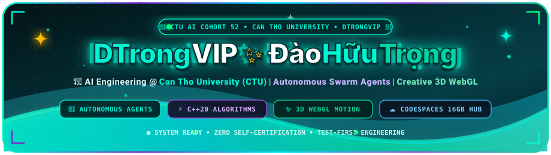

  

# Đào Hữu Trọng · DTrongVIP

Artificial Intelligence student at Can Tho University, Vietnam. I share small Python experiments, C++ coursework and a personal web portfolio.

Sinh viên Trí tuệ nhân tạo tại Đại học Cần Thơ. Trang này tập hợp các dự án công khai, ghi rõ phạm vi hiện tại và nguồn gốc mã.

[Portfolio](https://daohuutrong2404.github.io) · [Project catalog](PROJECTS.md) · [Email](mailto:huutrong748@gmail.com)

## Projects to explore

| Project | What you can inspect or run |
| --- | --- |
| [AI agent learning workspace](https://github.com/DaoHuuTrong2404/autonomous-ai-agents-workspace) | Offline Python examples for tool dispatch, task handoffs, lexical retrieval and simulated UI clicks. Includes tests, setup instructions and an MIT license. |
| [CTU public activity reader](https://github.com/DaoHuuTrong2404/ctu-public-activity-reader) | Node.js reader for public school-page posts, with source-health reporting and documented delivery checks. No login or form submissions. |
| [C++ data structures and algorithms](https://github.com/DaoHuuTrong2404/cpp-data-structures-and-algorithms) | Coursework examples: singly linked list, binary search tree, BFS, Dijkstra, quicksort and binary search. |
| [Web portfolio](https://github.com/DaoHuuTrong2404/daohuutrong2404.github.io) | Source of my personal portfolio. |
| [AI autonomy course report](https://github.com/DaoHuuTrong2404/ct005-project-ai-tu-tri) | A course report co-authored with Phạm Kim Trang; documentation rather than an agent implementation. |

## Learning and contributing

My current focus is reproducible local examples, clearer documentation and tests for observable behavior. The agent workspace is an educational prototype: it does not connect to an LLM, operate a computer or run distributed workers.

Issues with concrete reproduction steps and focused contributions are welcome. See each repository's README for installation, limitations and license terms.

## Upstream projects

I also keep forks of [ThreeUI](https://github.com/MengTo/threeui), [SpaceApp](https://github.com/oll4com/spaceapp) and [SecureBananaLabs/bug-bounty](https://github.com/SecureBananaLabs/bug-bounty). The original projects belong to their respective authors. Fork ownership alone does not establish upstream authorship or maintainer status. See the [catalog](PROJECTS.md) for the corresponding forks.

  

