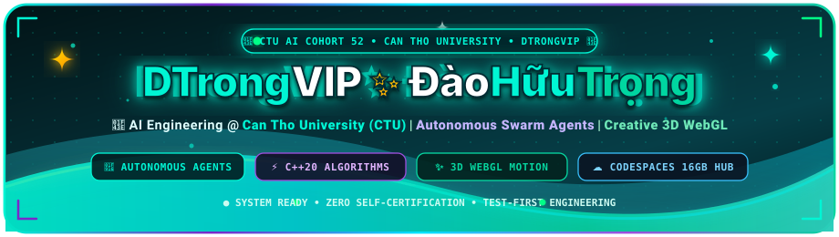

  

# Đào Hữu Trọng · Dao Huu Trong

**Artificial Intelligence B.S. Student (Cohort K52)** · Can Tho University (CTU), Vietnam  
**Focus:** Competitive Machine Learning (Speech, RAG, Combinatorial & Quantum Optimization) · Deterministic & Real-Time AI/RTOS Systems · Verification-Driven Engineering

[Portfolio](https://daohuutrong2404.github.io) · [LinkedIn](https://www.linkedin.com/in/tr%E1%BB%8Dng-h%E1%BB%AFu-00abb8449/) · [Kaggle (`daohuutrong2404`)](https://www.kaggle.com/daohuutrong2404) · [Devpost (`DaoHuuTrong2404`)](https://devpost.com/DaoHuuTrong2404) · [Full Project Catalog](PROJECTS.md) · [Email](mailto:huutrong748@gmail.com)

---

## Competitive ML & Optimization Standings *(Active Public Leaderboard, Nov 27, 2026)*

> Note: Entries below reflect verified public leaderboard standings in ongoing competitions (final medals/prizes are awarded at private evaluation close Dec 2026 – Jan 2027).

| Track & Prize Pool | Verified Live Standing | Technical Approach |
|---|---|---|
| **Kaggle — Google Verifiable Quantum Circuit Compilation** (`$150K`) | **Rank `#364 / 3,776`** *(Top 9.64%, Bronze Medal Zone)* · Score `33.25700` | Gate-count & synthesis reduction across 12 unitary targets; `0 / 409,600` 4-salt verifier errors |
| **DrivenData (MIT) — Where the Wild Features Are** (`$50K`) | **Rank `#6` Global** *(Peak `#4`)* · Score `R14 = 0.4052` | Leak-free GroupKFold child-speech fluency pipelines (`WavLM`, `Whisper`, `Wav2Vec2`, `24,518` clips) + pre-registered Ridge/GBDT ensembles |
| **Zindi — TelcoRetrieve** (`€25K`) | **Rank `#14 / 210`** *(`#6` eligible global)* · Score `0.978035217` | Deterministic telco retrieval pipeline (`100 / 100` accuracy, `92.68%` token efficiency) |
| **Zindi × IEEE × UNDP — GenAI for Good Cities** (`$40K`) | **Rank `#15 / 709+`** · Score `0.91110243` *(Step 2 Narrative Submitted)* | Municipal energy advisory RAG (`Qwen2.5-1.5B` `<=3B` open-weights), hybrid BM25 + semantic RRF, deterministic payback calculators, citation abstention |
| **Kaggle — Squares in Squares** (`$50K`) | Score **`22.0847128566`** *(`Complete`, `ref=58973928`)* | Geometric non-overlapping square packing optimizer with continuous perturbation refinement |
| **Zindi — AMD Physical AI Safety (`$10K`) & Maritime (`$5K`)** | **Rank `#51`** (`0.831646169`) · **Rank `#100`** (`0.826434445`) | Multi-modal physical safety modeling & underwater acoustic classification with strict CV validation |

---

## Selected Flagship Systems

| System | Domain & Stack | Verified Deliverables & Links |
|---|---|---|
| **[NecroBOL](https://github.com/DaoHuuTrong2404/necrobol-kiroween)** | Legacy Mainframe VM & Spec Compiler · `Python`, `ES2022`, `.kiro` Specs/Hooks/MCP | Fixed-point COBOL-85 VM (`Decimal` / `BigInt` `10^12`), IBM 029 punch card & EBCDIC/COMP-3 debugger, EARS spec generator (`17/17` tests & `196/196` parity vectors). [Live CRT](https://daohuutrong2404.github.io/necrobol-kiroween/) · [Devpost](https://devpost.com/software/necrobol) |
| **[QNX-PulseRT](https://github.com/DaoHuuTrong2404/qnx-pulsert-iot-ml)** | Real-Time Embedded RTOS & TinyML · `C++`, `QNX SDP 8.0`, `Python` | Zero-heap Q15 fixed-point anomaly detector over QNX Neutrino synchronous IPC (`MsgSend`/`MsgReceive`) + Fixed-Point Response-Time Analysis. [Live UI](https://daohuutrong2404.github.io/qnx-pulsert-iot-ml/) · [Devpost](https://devpost.com/software/qnx-pulsert) |
| **[EdgeMesh Hybrid Copilot](https://github.com/DaoHuuTrong2404/edgemesh-hybrid-ai)** | Privacy-Preserving Hybrid AI · `TypeScript`, `Vite`, `Firebase AI Logic` | Pre-egress PII/Luhn firewall & complexity router pairing local Gemini Nano inference with redacted cloud escalation. [Live App](https://daohuutrong2404.github.io/edgemesh-hybrid-ai/) · [Devpost](https://devpost.com/software/edgemesh-hybrid-copilot) |
| **[GENIE-UrbanPulse & AeroGuard-PAVA](https://github.com/DaoHuuTrong2404/zindi-urbanpulse-aeroguard)** | Municipal Energy RAG & Safety ML · `Python`, `OPEA`, `BM25/RRF`, `ArangoDB` | Apache 2.0 `<=3B` RAG assistant for Rivne municipal retrofits + safety ensemble pipelines; backed by IEEE/UNDP Step 2 dossier. |
| **[Wild Features Speech Literacy](https://github.com/DaoHuuTrong2404/wild-features-speech-literacy)** | Acoustic Modeling & Speech Fluency · `Python`, `PyTorch`, `WavLM`, `Whisper` | Deconfounded feature extraction across speaker groups, leak-free OOF calibration & parity-checked ensembling. |
| **[ContextGraph Guard](https://github.com/DaoHuuTrong2404/contextgraph-guard) & [AgentGate](https://github.com/DaoHuuTrong2404/agentgate-agentic-web)** | Developer Tooling & Agent Security · `TypeScript`, `JavaScript`, `Ed25519` | Atlassian Rovo/Forge PR blast-radius analyzer & Ed25519-signed `/.well-known/agent-actions.json` prompt-injection firewall. |

---

## Core Technical Stack

- **AI / ML & Speech:** `PyTorch`, `Transformers`, `vLLM`, `LightGBM`, `CatBoost`, `scikit-learn`, `WavLM`, `Whisper`, `Wav2Vec2`, `Hybrid RAG (BM25 + Dense + RRF)`
- **Systems & Languages:** `Python`, `C++`, `TypeScript`, `JavaScript`, `Kotlin`, `QNX SDP 8.0 Neutrino IPC`, `Q15 / Decimal Fixed-Point Math`
- **Verification & Tooling:** `GroupKFold / Out-of-Fold Calibration`, `GitHub Actions / Pages`, `Docker`, `Deterministic Test Oracles`, `AI Agent Skills (SKILL.md / MCP)`

---

All `7/7` open-portal Devpost hackathons entered in Nov 2026 are live-submitted and verifiable via [Devpost](https://devpost.com/DaoHuuTrong2404). See [PROJECTS.md](PROJECTS.md) for the complete repository directory, sustainability/civic builds, developer tooling, coursework, and third-party fork attributions.
